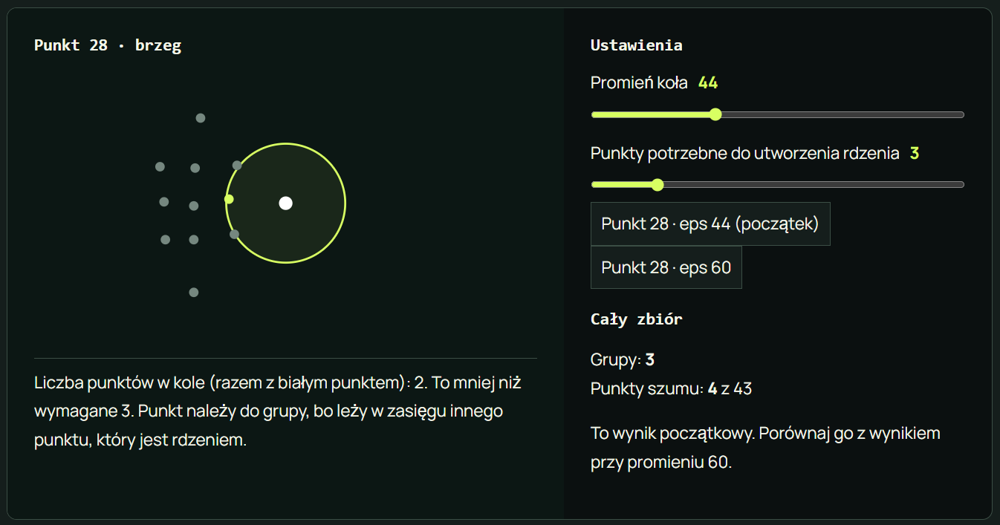
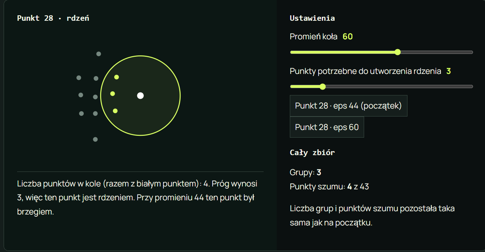
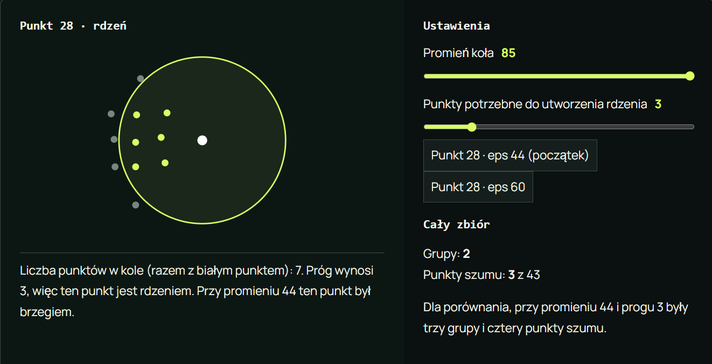
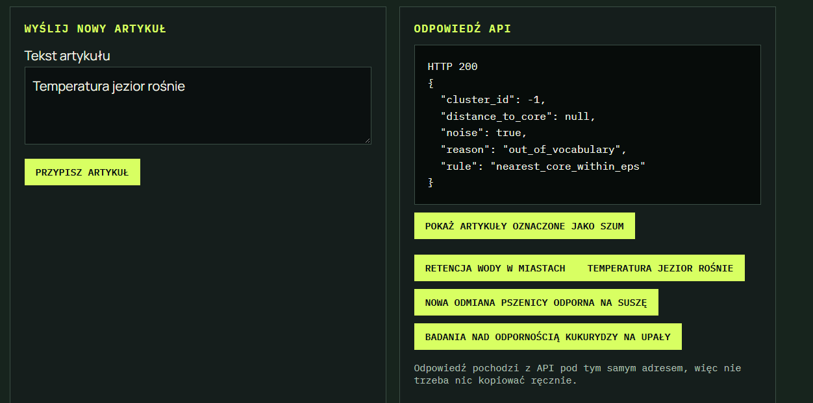

# LAB 05 - DBSCAN, K-Means i Agglomerative

> Wykorzystaliśmy rozszerzony zbiór `articles.csv` z poprzedniego zadania, ktory zawiera 52 artykuły (dodatkowe teksty związane między innymi z rolnictwem).

# Zadanie 1 - Analiza punktu 28

Sprawdziliśmy punkt 28 dla trzech różnych wartości promienia przy stałym progu:

```text
MIN_SAMPLES = 3
```

## Wyniki

| Promień (eps) | Liczba punktów w kole | Rola punktu |
| ------------- | --------------------- | ----------- |
| 44            | 2                     | Brzeg       |
| 60            | 4                     | Rdzeń       |
| 85            | 7                     | Rdzeń       |

---

## EPS = 44



Przy promieniu 44 w kole znajdowały się tylko 2 punkty (łącznie z badanym punktem). Jest to mniej niż wymagane 3 punkty, dlatego punkt 28 nie mógł zostać rdzeniem. Punkt należał jednak do istniejącej grupy, ponieważ znajdował się w zasięgu innego punktu będącego rdzeniem.

**Rola punktu:** brzeg.

---

## EPS = 60



Po zwiększeniu promienia do 60 w kole znalazły się 4 punkty. Próg wynosił 3 punkty, dlatego warunek utworzenia rdzenia został spełniony.

**Rola punktu:** rdzeń.

---

## EPS = 85



Przy promieniu 85 liczba punktów w sąsiedztwie wzrosła do 7. Punkt nadal spełniał warunek utworzenia rdzenia, ponieważ liczba punktów znacząco przekraczała wymagany próg.

**Rola punktu:** rdzeń.

---

Wraz ze zwiększaniem promienia (`eps`) liczba punktów znajdujących się w sąsiedztwie punktu 28 rosła:

```text
EPS = 44 -> 2 punkty -> brzeg
EPS = 60 -> 4 punkty -> rdzeń
EPS = 85 -> 7 punktów -> rdzeń
```

Oznacza to, że zwiększenie promienia może zmienić punkt brzegowy w punkt rdzeniowy, ponieważ obejmuje on większą liczbę sąsiadó

---

<br>

# Zadanie A - Porównanie wartości `EPS` przy `MIN_SAMPLES = 3`

W celu sprawdzenia wpływu parametru `EPS` na działanie algorytmu DBSCAN wykonaliśmy trzy pomiary dla wartości:

```text
EPS = 0.70
EPS = 0.74
EPS = 0.79
```

przy stałej wartości:

```text
MIN_SAMPLES = 3
```

## Wyniki

| EPS  | Liczba grup | Liczba artykułów oznaczonych jako szum | Ocenione artykuły | Silhouette |
| ---- | ----------- | -------------------------------------- | ----------------- | ---------- |
| 0.70 | 7           | 8                                      | 44                | 0.241      |
| 0.74 | 7           | 4                                      | 48                | 0.220      |
| 0.79 | 4           | 2                                      | 50                | 0.140      |

---

## Artykuły oznaczone jako szum

### EPS = 0.70

```text
Koncert orkiestry w teatrze
Muzyczny debiut zespołu
Las wraca po pożarze
Retencja wody w miastach
Odpady trafiają do recyklingu
Temperatura jezior rośnie
Nowa odmiana pszenicy odporna na suszę
Badania nad odpornością kukurydzy na upały
```

Przy najmniejszym promieniu algorytm miał największe problemy z odnalezieniem odpowiedniej liczby sąsiadów, dlatego aż 8 artykułów zostało oznaczonych jako szum.

---

### EPS = 0.74

```text
Retencja wody w miastach
Temperatura jezior rośnie
Nowa odmiana pszenicy odporna na suszę
Badania nad odpornością kukurydzy na upały
```

Po zwiększeniu promienia liczba artykułów oznaczonych jako szum zmniejszyła się z 8 do 4. Część artykułów uzyskała wystarczającą liczbę sąsiadów, aby zostać przypisana do istniejących grup.

---

### EPS = 0.79

```text
Retencja wody w miastach
Temperatura jezior rośnie
```

Przy największym promieniu tylko 2 artykuły pozostały szumem. Jednocześnie liczba grup spadła do 4, ponieważ część wcześniej oddzielnych klastrów została połączona.

---

<br>

# Zadanie B - Wybór metody dla redakcji

### Porównanie metod

| Algorytm      | Grupy | Szum | Silhouette cosine | Ocenione artykuły |
| ------------- | ----- | ---- | ----------------- | ----------------- |
| K-Means       | 5     | 0    | 0.156             | 52                |
| DBSCAN        | 7     | 4    | 0.220             | 48                |
| Agglomerative | 5     | 0    | 0.165             | 52                |

---

### Wniosek

Wybraliśmy **DBSCAN**.

Osiągnął najwyższą wartość współczynnika silhouette (`0.220`), co oznacza lepsze rozdzielenie grup niż w przypadku K-Means (`0.156`) oraz Agglomerative (`0.165`).

Dodatkowo DBSCAN potrafi wykrywać artykuły, które nie pasują do żadnej grupy i oznaczać je jako szum. Przykładem jest artykuł:

```text
Temperatura jezior rośnie
```

Artykuł ten został oznaczony jako szum (`-1`), ponieważ nie miał wystarczającej liczby podobnych sąsiadów. Dzięki temu redakcja może łatwo zauważyć nietypowe lub trudne do zaklasyfikowania teksty zamiast przypisywać je na siłę do jednej z istniejących kategorii.

Współczynnik silhouette został obliczony dla:

```text
48 artykułów
```

ponieważ 4 artykuły zostały oznaczone przez DBSCAN jako szum i nie zostały uwzględnione w obliczeniach.

---

<br>

## Zadanie C

### Modyfikacja interfejsu

Po kliknięciu przycisku **„Pokaż artykuły oznaczone jako szum”** lista artykułów jest pobierana z endpointu:

```text
GET /api/noise
```

Zamiast wyświetlania zwykłego tekstu tytuły artykułów są dynamicznie zamieniane na przyciski.

Kliknięcie przycisku powoduje automatyczne wpisanie tytułu artykułu do pola:

```html
<textarea id="article">
```

Dzięki temu użytkownik może od razu sprawdzić, jak API sklasyfikuje wybrany artykuł oznaczony wcześniej jako szum.

### Efekt działania



Po kliknięciu jednego z przycisków jego tytuł zostaje automatycznie wstawiony do formularza i może zostać ponownie wysłany do endpointu klasyfikującego artykuły.
